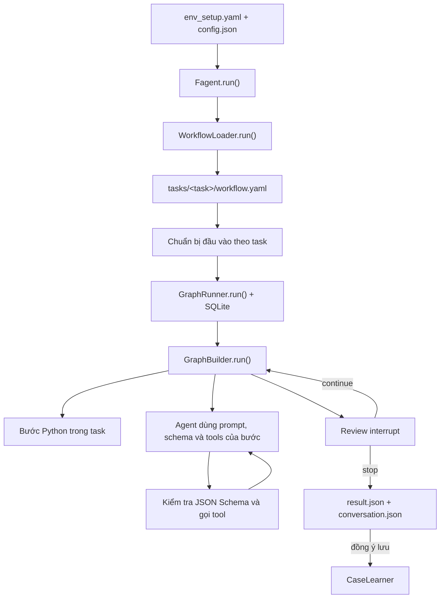

# Luồng thực thi FAGENT



## Trách nhiệm các module

| Module | Trách nhiệm |
| --- | --- |
| `FAGENT/fagent.py` | Đọc setup và cấu hình chung, chọn task, chạy từng bộ đầu vào |
| `engine/workflow_loader.py` | Kiểm tra đường dẫn, schema, callable, route và tính digest từ workflow cùng asset |
| `engine/graph_builder.py`, `engine/graph_nodes.py` | Biên dịch route, chạy step, điều phối agent/tool và review |
| `engine/graph_services.py` | Cấp dịch vụ model, layout, RAG và backend EDA |
| `engine/graph_runner.py` | Điều phối SQLite checkpoint, tiếp nhận phản hồi và ghi artifact |
| `engine/trace.py` | Ghi task, node, tool, trạng thái và route đã chọn khi bật `--verbose` |
| `tasks/drc/` | Chuẩn bị báo cáo và GDS theo cell, kiểm tra thứ tự đọc trước sửa, lưu candidate và xác minh bằng chứng |
| `tasks/lvs/` | Đọc trạng thái đầu vào và chạy kiểm tra mô phỏng đã cấu hình |
| `knowledge/templates/` | Giao thức, prompt review, schema và mẫu báo cáo dùng chung |

DRC đọc rule deck và layer map theo setup. Mỗi lần sửa lưu dấu SHA-256 của candidate vào state. Runner kiểm tra định danh workflow, cấu hình và candidate trước khi resume checkpoint. DRC/LVS mô phỏng gắn `simulated: true`; việc lưu tri thức yêu cầu người dùng đồng ý qua review.

Trace ghi ra stderr. Trace ghi bằng tiếng Anh, kèm step và thao tác đang thực hiện. Khi chọn xong route, trace ghi node tiếp theo. Khi chờ review, trace ghi `Waiting for human feedback`. Conversation và các kết quả chi tiết nằm trong artifact của rundir.

## Luồng chi tiết

### 1. CLI, cấu hình và chuẩn bị từng lượt chạy

Cả `python -m FAGENT` và lệnh `fagent` gọi `Fagent.main()` rồi vào `Fagent.run()`. CLI đọc `--setup`, `--config` và `--verbose`. Setup chọn task và cung cấp đầu vào từng lượt chạy. Cấu hình JSON cung cấp môi trường model, tài nguyên và tri thức dùng chung. Các đường dẫn đầu vào tương đối trong setup được tính từ thư mục chứa YAML.

`Fagent.run_setup()` duyệt các mục trong `tasks`, nạp định nghĩa bằng `load_task_workflow()` và tạo cấu hình riêng cho lượt chạy. Nếu workflow khai báo `prepare`, hàm đó trả về từng bộ `(rundir, config, inputs)`. Workflow đơn giản có thể dùng trực tiếp cấu hình task làm đầu vào và chạy một lượt.

| Task | Đầu vào | Thư mục chạy |
| --- | --- | --- |
| DRC | `list_cells`, `layer_map_files`, `drc_folder`, `drc_files` và prompt tùy chọn | `<output_folder>/<cell>/rundir/` |
| LVS | Cấu hình task và đường dẫn báo cáo tùy chọn `lvs_report` | `<output_folder>/lvs/rundir/` |

Ví dụ, nếu `list_cells` chứa `ROM_MCELL0` và `drc_folder` là `DRC`, bước chuẩn bị lấy `DRC/ROM_MCELL0.gds` và `DRC/ROM_MCELL0.drc.results`. `InputLoader` gọi các bộ phân tích GDS và DRC, rồi ghi `gds.json` và `drc.json` trong rundir. CLI kiểm tra artifact đã tồn tại trước khi chạy graph.

### 2. Nạp và xác thực workflow

1. `WorkflowLoader.run()` tìm `FAGENT/tasks/<task>/workflow.yaml` và kiểm tra định danh task, cấu trúc YAML, ID bước và route `next` hoặc `continue`.
2. Loader xác thực đường dẫn prompt, schema và mã Python tham chiếu trước khi thực thi module. Đường dẫn tuyệt đối, thành phần `..` và symlink thoát khỏi thư mục cho phép bị từ chối. Mã task được thực thi với quyền của tiến trình FAGENT.
3. Loader phân giải `module:callable`, kiểm tra chữ ký step/tool, metadata và JSON Schema. Mỗi bước agent có bộ tool riêng.
4. Loader tính digest từ nội dung workflow, asset được tham chiếu và mã nguồn callable đã nạp. `GraphRunner` dùng digest này cùng định danh task, version và digest cấu hình khi kiểm tra checkpoint.

### 3. Khởi tạo dịch vụ và chạy graph

`Fagent.run_graph()` tạo `GraphServices`. Container lắp adapter llama.cpp và ghép prompt task, prompt bổ sung và giao thức chung. Với workflow bật `layout_services`, container nạp `LayoutService`, chuẩn bị RAG, lập chỉ mục tài liệu và rule deck, rồi ghép các đoạn tham khảo được truy xuất vào ngữ cảnh.

`GraphRunner.prepare_graph()` mở SQLite checkpointer, biên dịch graph qua `GraphBuilder.run()` và cấu hình thread cùng giới hạn đệ quy. Bước đầu trong YAML nối với `START`. Các route thực tế được chọn từ kết quả thực thi và khai báo của workflow.

- **Step Python.** `GraphNodes.execute_step()` gọi callable với `TaskContext(task, inputs, state, services)`. Step trả về cập nhật state tương thích JSON. Nếu thiếu đầu vào bắt buộc hoặc step lỗi, graph ghi lỗi có định danh task/bước và trả `incomplete`.
- **Agent.** `execute_agent()` gửi conversation, schema phản hồi và đúng danh sách tool của bước hiện tại. Nếu model gọi tool, graph chuyển đến node `<step>--tools`. Nếu model trả lời cuối, engine kiểm tra JSON Schema trước khi đi tới `next`.
- **Tool.** `execute_tools()` kiểm tra ID lệnh gọi, tên tool và schema đối số trước khi gọi. Kết quả hoặc lỗi được đưa vào conversation với cùng `tool_call_id`. `ToolResult` có thể kèm cập nhật state, ví dụ đường dẫn và digest của candidate. Graph quay lại agent. Khi hết số vòng cho phép, lượt chạy kết thúc với `incomplete`.
- **Review.** Node tạm dừng qua LangGraph interrupt. `continue` đi đến bước do workflow chỉ định. `unclear` lặp lại review. `stop` đi theo `next`.

### 4. Nhánh DRC và LVS

| Bước | DRC | LVS |
| --- | --- | --- |
| `read` | Đọc `drc.json` và thêm các rule cần xử lý vào conversation | Đưa trạng thái đọc báo cáo và đường dẫn đầu vào tùy chọn vào conversation |
| `repair` | Agent dùng `read_gds` để xem polygon, rồi có thể gọi `replace_polygon` | Trả trạng thái `unavailable` cho khả năng sửa LVS |
| `validate` | Kiểm tra digest candidate trước khi gọi backend. Calibre Simulator xuất results và summary, sau đó runner đối chiếu top cell và tổng số vi phạm | Nếu cấu hình bật mock cho backend local, trả `pass` với `simulated: true` |
| `human_review` | Hiển thị bằng chứng và hỏi phản hồi. Người dùng có thể đồng ý lưu tri thức qua lời nhắc riêng | Hiển thị kết quả và hỏi phản hồi |

Tool `replace_polygon` yêu cầu đọc đúng cell trước khi sửa. Marker trong báo cáo Calibre dùng DBU. Tọa độ tool dùng GDS user units, nên cần chia tọa độ DBU cho `dbu_per_user_unit`. Khi lưu thành công, tool cập nhật `candidate.gds` và SHA-256 của file. Bằng chứng DRC mô phỏng được đánh dấu `simulated: true`. Backend EDA thật hiện trả `unavailable`.

### 5. Checkpoint, review và artifact

Trong cùng lượt chạy, `GraphRunner.finish()` nhận feedback ở mỗi interrupt và kiểm tra lại checkpoint trước khi tiếp tục. Để mở lại một review đã lưu qua API Python, chuẩn bị dịch vụ cho chế độ resume, tạo `GraphRunner` với cùng rundir và `thread_id`, rồi gọi `resume(feedback)`. Runner mở lại SQLite, kiểm tra review đang chờ và so sánh định danh workflow. Khi có candidate, runner kiểm tra đường dẫn và SHA-256 trước khi nạp lại layout. Thay đổi asset hoặc cấu hình có thể làm checkpoint cũ bị từ chối. CLI hiện cung cấp ba cờ `--setup`, `--config` và `--verbose`.

| Artifact | Nội dung |
| --- | --- |
| `gds.json`, `drc.json` | Hình học và báo cáo đầu vào đã phân tích cho DRC |
| `candidate.gds` | Layout DRC sau khi tool lưu lần sửa |
| `drc-validation-*/` | Kết quả và summary từ Calibre Simulator |
| `graph-checkpoints.sqlite3` | State và interrupt theo thread |
| `conversation.json` | Lịch sử conversation, kể cả lệnh gọi và phản hồi tool |
| `result.json` | Định danh lượt chạy, trạng thái, bằng chứng, candidate digest và quyết định review |

`CaseLearner` chỉ chạy khi workflow bật lưu tri thức, review kết thúc với sự đồng ý rõ ràng và graph không bị lỗi. Với `--verbose`, trace đi ra stderr theo thứ tự thực thi, gồm cả các lượt lặp và trạng thái chờ feedback. Kết quả JSON của lượt chạy được in ra stdout sau khi ghi artifact.

## Cây thư mục

```text
.
├── .agent/
│   ├── AGENTS.md                      # Quy tắc làm việc của repo
│   └── AI_Workflow.md                 # Tài liệu luồng hiện tại
├── CALIBRE/
│   └── calibre_simulator.py           # Mô phỏng DRC và xuất báo cáo
├── DRC/                               # GDS, rule deck và báo cáo mẫu
├── config/                            # Layer map và cấu hình hiển thị layer
├── FAGENT/
│   ├── __init__.py
│   ├── __main__.py                    # Entry point python -m FAGENT
│   ├── fagent.py                      # CLI, setup và điều phối từng lượt
│   ├── config.json                    # Cấu hình môi trường cục bộ
│   ├── config.example.json            # Mẫu cấu hình
│   ├── capabilities/
│   │   ├── drc/
│   │   │   └── drc_parser.py          # Phân tích results và summary
│   │   └── layout/
│   │       ├── input_loader.py        # Kiểm tra và chuẩn bị artifact đầu vào
│   │       ├── layout_service.py      # Đọc/sửa polygon và lưu GDS
│   │       └── process_gds.py         # Phân tích GDSII và ánh xạ layer
│   ├── engine/
│   │   ├── fagent_state.py            # State tuần tự hóa của LangGraph
│   │   ├── task_contracts.py          # TaskContext, metadata tool, ToolResult
│   │   ├── workflow_loader.py        # Nạp, xác thực và tính digest
│   │   ├── graph_builder.py          # Biên dịch node và route
│   │   ├── graph_nodes.py            # Step, agent, tool, review và điều hướng
│   │   ├── graph_runner.py           # Checkpoint, resume và artifact
│   │   ├── graph_services.py         # Model, layout, RAG và EDA
│   │   └── trace.py                  # Định dạng trace trực tiếp
│   ├── integrations/
│   │   ├── eda_tools/
│   │   │   ├── drc_runner.py         # Backend DRC và đối chiếu báo cáo
│   │   │   └── lvs_runner.py         # Backend mock LVS
│   │   └── models/
│   │       ├── __init__.py
│   │       └── llama_adapter.py       # Chat, tool calling và embedding GGUF
│   ├── knowledge/
│   │   ├── rag.sqlite3               # Kho tri thức và vector
│   │   ├── records.json              # Snapshot JSON của bản ghi
│   │   └── templates/
│   │       ├── prompts/
│   │       │   ├── drc_site.md         # Hướng dẫn bổ sung cho site
│   │       │   ├── protocol.md         # Giao thức phản hồi model
│   │       │   └── review.md           # Prompt phân loại feedback
│   │       ├── reports/
│   │       │   └── drc_summary.txt     # Mẫu summary mô phỏng
│   │       └── schemas/
│   │           ├── review.json        # Schema phản hồi review
│   │           └── workflow.json      # Schema định nghĩa workflow
│   ├── rag/
│   │   ├── __init__.py
│   │   ├── case_learner.py            # Lưu case được review chấp thuận
│   │   ├── hybrid_retriever.py        # Truy xuất rule, từ khóa và vector
│   │   ├── knowledge_indexer.py       # Lập chỉ mục tài liệu và deck
│   │   └── knowledge_store.py         # SQLite và snapshot
│   └── tasks/
│       ├── __init__.py
│       ├── drc/
│       │   ├── __init__.py
│       │   ├── workflow.yaml          # read → repair → validate → review
│       │   ├── steps.py               # Chuẩn bị theo cell, đọc và validate
│       │   ├── tools.py               # read_gds và replace_polygon
│       │   ├── prompts/drc.md
│       │   └── schemas/drc.json
│       └── lvs/
│           ├── __init__.py
│           ├── workflow.yaml          # read → placeholder → mock → review
│           ├── steps.py               # Chuẩn bị, đọc, placeholder và validate
│           ├── tools.py               # Module tool hiện chưa có callable
│           ├── prompts/lvs.md
│           └── schemas/lvs.json
├── tests/
│   ├── fixtures/tasks/migrate_gds/     # Task thử nghiệm có workflow, step, tool và asset
│   ├── test_task_loader.py
│   ├── test_task_execution.py
│   ├── test_task_regression.py
│   ├── test_trace.py
│   └── test_package.py
├── env_setup.yaml                     # Chọn task và đầu vào từng lượt
├── list                               # Danh sách cell mẫu
├── cmd                                # Lệnh chạy từ setup
├── calibre.sh                         # Script chạy simulator
├── pyproject.toml                     # Entry point và package data
├── requirements.txt
└── README.md
```
