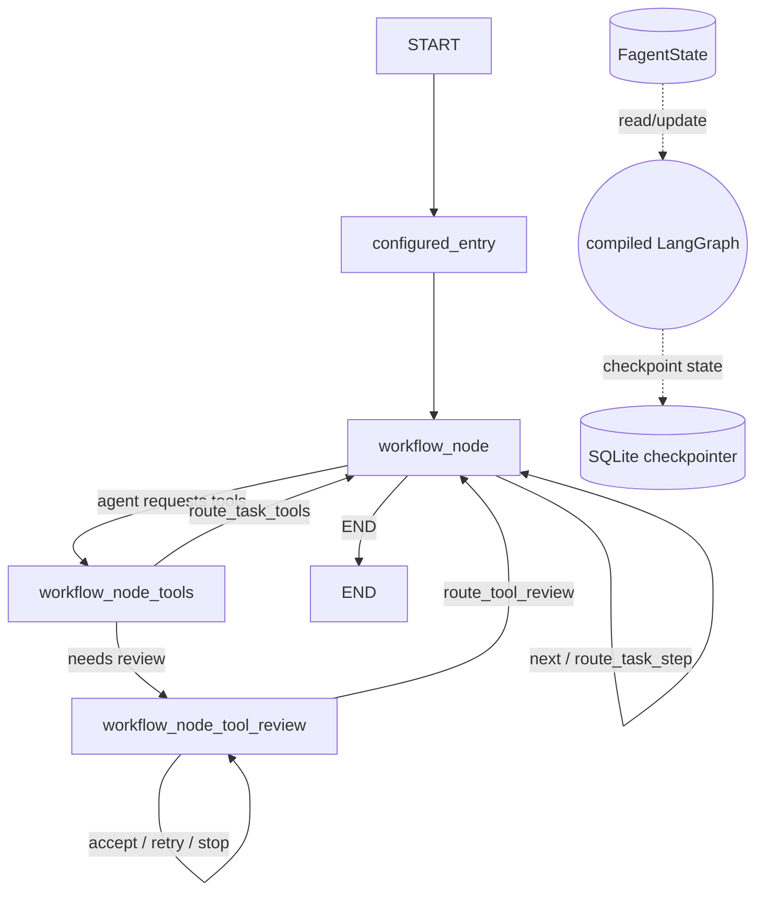
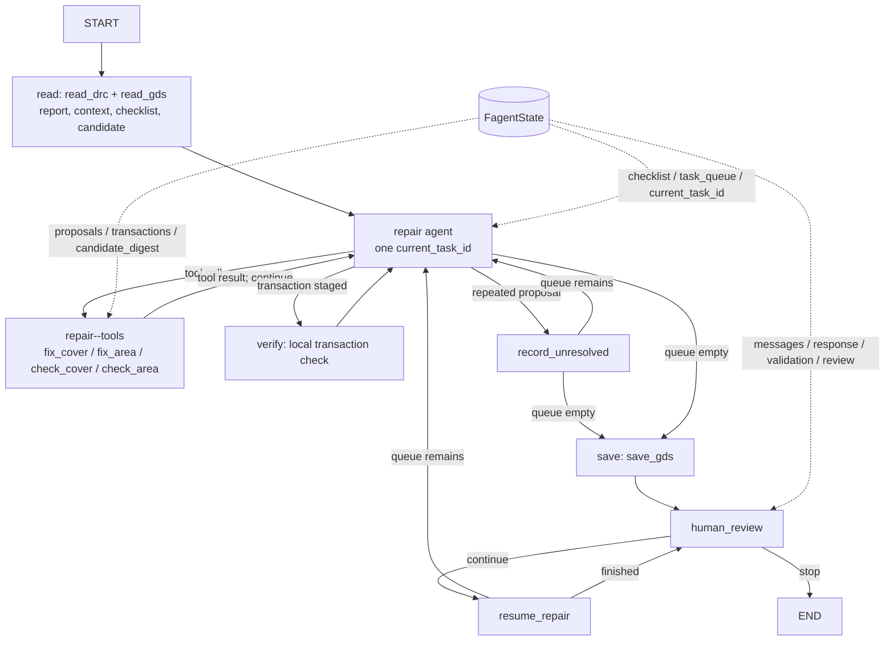

# FAGENT DRC AI Workflow

Tài liệu này mô tả đường chạy DRC đang được cấu hình trong `FAGENT/tasks/drc/workflow.yaml`. Graph dùng `FagentState`; các node và nhánh được tạo từ YAML bởi `GraphBuilder`. Checklist được khởi tạo từ report, lọc theo goal bằng embedding khi có goal hoặc `skip_prompt`, rồi mỗi violation còn hoạt động được xử lý lần lượt. Việc sửa hình học đi qua proposal có kiểm tra trên candidate GDS; node `save` lưu candidate sau khi hàng đợi kết thúc.

## 1. Cấu trúc

### 1.1 Backbone graph của engine

`GraphBuilder.run()` tạo `StateGraph(FagentState)`, đăng ký mỗi workflow step thành node và thiết lập cạnh tĩnh hoặc conditional edge dựa trên `next`, `routes`, `router`. Với node `agent`, builder thêm node thực thi tool và node review tool. `GraphRunner` khởi tạo state ban đầu, invoke graph và ghi checkpoint.



`workflow_node` ở hình là node step có tên thực tế từ YAML; suffix `--tools` và `--tool-review` chỉ được tạo cho agent step. Các cạnh route thực tế phụ thuộc workflow đang nạp.

**Bằng chứng trong mã:** [`graph_builder.py`](../FAGENT/engine/graph_builder.py) định nghĩa StateGraph, node, tool node, review node và cạnh; [`fagent_state.py`](../FAGENT/engine/fagent_state.py) định nghĩa state; [`graph_runner.py`](../FAGENT/engine/graph_runner.py) invoke graph với SQLite checkpointer và hoàn tất kết quả.

### 1.2 Node, state và edge riêng của DRC



Các trạng thái DRC quan trọng:

| Nhóm | State keys | Ý nghĩa |
|---|---|---|
| Đầu vào và hội thoại | `inputs`, `messages`, `report`, `drc_context` | Tệp đầu vào, lịch sử model, report và dữ liệu layout/rule liên quan |
| Checklist và điều phối | `checklist`, `checklist_digest`, `checklist_path`, `task_queue`, `current_task_id`, `task_history` | Các violation được giữ lại, thứ tự xử lý và kết quả từng marker |
| Candidate GDS | `candidate_path`, `candidate_digest`, `proposals`, `task_transactions`, `task_checks` | Candidate làm việc, proposal gắn digest, transaction và kết quả local check |
| Kết thúc / tiếp tục | `validation`, `result`, `review`, `save_completed`, `identity` | Trạng thái validation, kết quả tổng hợp, human review và metadata phục hồi |

**Bằng chứng trong mã:** [`workflow.yaml`](../FAGENT/tasks/drc/workflow.yaml) là nguồn node/route/tool; [`steps.py`](../FAGENT/tasks/drc/steps.py) định nghĩa read, verify, save và queue routing; [`graph_nodes.py`](../FAGENT/engine/graph_nodes.py) điều phối agent, tool calls, queue và checklist; [`fagent_state.py`](../FAGENT/engine/fagent_state.py) khai báo field.

### 1.3 Checklist được lập và lọc ra sao

`read_drc` đọc report, tạo summary các rule, rồi gọi `_select_checklist_rules`. Hàm tạo embedding cho goal (nếu có), `skip_prompt` (nếu có), và chuỗi `rule + description` cho từng rule. Nó tính cosine distance:

- Có goal: giữ rule có distance tới goal `<= skip_distance_threshold`.
- Có `skip_prompt`: trong tập còn lại, loại rule có distance tới skip prompt `< skip_distance_threshold`.
- Không có goal và skip prompt hoặc không có violation: giữ nguyên các rule trong report, không gọi embedding.

Giá trị `skip_distance_threshold` lấy từ config; code kiểm tra miền `0..2`. Các giá trị mẫu mặc định trong hàm là `skip_prompt=''`, threshold `0.5`; model embedding path được cấu hình riêng. Sau khi lọc, `Checklist.run(report, selected_rules=...)` tạo task theo các violation tương ứng. DRC rule/deck evidence dùng parser/regex ở `rule_evidence.py` là một xử lý khác, không thay thế bộ lọc embedding theo goal.

```json
{
  "checklist": {
    "tasks": [
      {
        "task_id": "task-1",
        "rule": "RULE_FROM_REPORT",
        "violation_id": "ID_FROM_REPORT",
        "occurrence": 0,
        "work": "",
        "status": "pending",
        "reason": "",
        "polygon_ids": [],
        "evidence": [],
        "stale": false
      }
    ],
        "digest": "sha256-of-canonical-task-list"
  },
  "task_queue": ["task-1"],
  "current_task_id": "task-1"
}
```

ID, rule, occurrence và digest trong ví dụ có tính minh họa; ID thực tế được tạo từ report và thứ tự của nó. Mỗi violation occurrence có task riêng.

**Bằng chứng trong mã:** [`steps.py`](../FAGENT/tasks/drc/steps.py) có `_select_checklist_rules` và `read_drc`; [`checklist.py`](../FAGENT/tasks/drc/checklist.py) tạo/persist task và digest; [`rule_evidence.py`](../FAGENT/tasks/drc/rule_evidence.py) trích bằng chứng rule từ deck; cấu hình embedding nằm ở [`config_ollama.json`](../config_ollama.json).

### 1.4 GDS được sửa bằng tool nào

GDS đầu vào được nạp qua layout service; `read_gds` đọc cell vào context và checkpoint một candidate riêng. Model không gửi bytes GDS hay thay trực tiếp tọa độ trong file. Thay vào đó, nó chọn polygon ID từ layout context và gọi tool có schema giới hạn:

1. Coverage/enclosure: `fix_cover(action="propose", ...)` nhận `inner_id`, các `groups` polygon cover, và `minimum_enclosure` theo GDS user units.
2. Minimum area: `fix_area(action="propose", ...)` nhận `polygon_id` và `minimum_area` suy ra từ rule text.
3. Tool dựng proposal trên geometry hiện tại. Proposal gắn `task_id`, loại sửa, polygon IDs, `candidate_digest`, changes và bound inputs.
4. Nếu proposal hợp lệ, model gọi lại `fix_cover`/`fix_area` với `action="apply"` và `proposal_id`. Apply kiểm tra candidate digest; geometry được cập nhật giao dịch trên candidate và checkpoint.
5. `verify` hoặc `check_cover`/`check_area` kiểm tra staged edit. Nếu check fail, thay đổi được rollback; pass là local check cho marker/candidate hiện tại, không đồng nghĩa toàn bộ deck DRC đã sạch.
6. Sau khi queue xong, node `save` gọi `save_gds`; đây là node workflow, không phải model tool trong `repair.tools`. Candidate cuối được lưu và có digest.

**Bằng chứng trong mã:** [`tools.py`](../FAGENT/tasks/drc/tools.py) định nghĩa proposal/apply/check/save; [`workflow.yaml`](../FAGENT/tasks/drc/workflow.yaml) xác định tools và node save; [`graph_nodes.py`](../FAGENT/engine/graph_nodes.py) lọc tool schema theo giai đoạn và dispatch call; [`steps.py`](../FAGENT/tasks/drc/steps.py) đọc/checkpoint GDS và gọi save; các builder hình học nằm trong [`repair_proposals.py`](../FAGENT/capabilities/layout/repair_proposals.py).

## 2. Triển khai một lượt DRC

Ví dụ dưới đây cho thấy cấu trúc dữ liệu tại các ranh giới chính. Giá trị như rule, ID, tọa độ, digest, tool call ID và kết quả đo là giá trị minh họa; cấu trúc trường theo code. Một workflow DRC hoàn chỉnh có planner node riêng, nhưng `workflow.yaml` hiện tại khai báo `read → repair`; vì vậy phần checklist không được gửi như một planner request độc lập trong luồng cấu hình hiện tại. `repair` nhận system prompt cùng user payload của marker hiện hành.

### 2.1 Lệnh chạy và prompt đầu vào

CLI đọc setup YAML và config JSON; task và output folder được lấy từ setup. Ví dụ theo parser hiện tại (thay các file bằng setup/config của run):

```bash
python -m FAGENT.fagent --setup env_setup.yaml --config config_ollama.json --verbose
```

Trong lúc `prepare`, `GraphServices` nạp layout, DRC report, layer map, chat client và RAG/context. `read_drc` tạo system message từ goal + constraints. **System policy** có cấu trúc văn bản sau (các dòng chỉ xuất hiện khi có giá trị cấu hình):

```text
<goal từ config>

Constraints:
- <constraint 1>
- <constraint 2>
```

`read_drc` lọc và lưu checklist. Sau đó `read_gds` chọn target cell và tạo/đọc candidate. Mỗi request repair sử dụng node prompt trong [`repair.md`](../FAGENT/tasks/drc/prompts/repair.md), sau đó nối system policy. Prompt yêu cầu đọc đầy đủ rule/marker, chỉ dùng polygon ID được cấp, không suy diễn giới hạn, báo unresolved khi evidence/tool không đủ, và dùng tool phù hợp.

User prompt của request repair được tạo bởi `model_payload.build_request`; đó là JSON object, không phải câu hỏi văn bản tự do:

```json
{
  "task_id": "task-1",
  "cell": "TOP_CELL_FROM_INPUT",
  "unit": "um",
  "grid": 0.001,
  "violation": {
    "rule": "RULE_FROM_REPORT",
    "description": "description parsed from DRC report",
    "rule_text": "full matching rule block when available",
    "marker_bbox": [10.0, 20.0, 10.2, 20.1],
    "marker_metrics": {"w": 0.2, "h": 0.1, "area": 0.02},
    "marker_points": [[10.0, 20.0], [10.2, 20.0], [10.2, 20.1], [10.0, 20.1]],
    "evidence": {
      "status": "available",
      "reason": null,
      "deck_file": "configured-deck.drc",
      "line_start": 100,
      "line_end": 104,
      "mapping_diagnostics": {}
    }
  },
  "layer_map": {"LAYER_NAME_FROM_EVIDENCE": [10, 0]},
  "layout": {
    "search_region": [9.0, 19.0, 11.0, 21.0],
    "complete": true,
    "candidate_digest": "sha256-candidate",
    "polygons": [
      {
        "id": "polygon-id-from-layout",
        "layer": "LAYER_NAME_FROM_EVIDENCE",
        "lpp": [10, 0],
        "points": [[10.0, 20.0], [10.5, 20.0], [10.5, 20.5], [10.0, 20.5]],
        "bbox": [10.0, 20.0, 10.5, 20.5],
        "editable": true,
        "is_violating": null,
        "w": 0.5,
        "h": 0.5,
        "area": 0.25
      }
    ],
    "layer_status_in_search_region": {"LAYER_NAME_FROM_EVIDENCE": "present"},
    "references_in_region": [],
    "paths_in_region": [],
    "reason": null
  },
    "task_history": []
}
```

`build_model_request` gửi dạng chat messages. System message gồm repair prompt + policy; user message là JSON serialization của object trên. Request builder hiện đặt `task_history` thành `[]`; lịch sử assistant/tool của task được thêm lại khi cần để hoàn tất chu trình tool.

### 2.2 Checklist tới model request/response

Checklist đầy đủ ở state có dạng `{"tasks": [...], "digest": "..."}`; mỗi task có `task_id`, `rule`, `violation_id`, `occurrence`, `work`, `status`, `reason`, `polygon_ids`, `evidence`, `stale`. Trong workflow hiện tại, request repair tập trung vào `current_task_id`; payload không gửi cả checklist như planner input. Checklist vẫn nằm trong graph state và được cập nhật khi marker kết thúc.

Request schema tool ở lượt repair được thu hẹp theo trạng thái:

- Chưa có proposal: expose `fix_cover` hoặc `fix_area` với `action: "propose"` và các tham số proposal.
- Có proposal đúng task và candidate digest: expose tool sửa tương ứng chỉ với `action: "apply"` và `proposal_id` hợp lệ.
- Có transaction đang chờ kiểm tra: expose `check_cover` hoặc `check_area`.
- Check pass gắn với digest candidate hiện tại: không gửi tool nữa; schema kết quả cho phép completion.

Ví dụ model request (envelope chat đã chuẩn hóa; adapter backend có thể bổ sung metadata riêng):

```json
{
  "messages": [
    {"role": "system", "content": "<repair.md đầy đủ>\n\n<goal và constraints>"},
    {"role": "user", "content": "<JSON user payload đầy đủ như mục 2.1>"}
  ],
  "tools": [
    {
      "type": "function",
      "function": {
        "name": "fix_area",
        "description": "Repair a minimum-area violation...",
        "parameters": {
          "type": "object",
          "properties": {
            "task_id": {"type": "string", "const": "task-1"},
            "action": {"type": "string", "enum": ["propose"]},
            "polygon_id": {"type": "string"},
            "minimum_area": {"type": "number"}
          },
          "required": ["task_id", "action", "polygon_id", "minimum_area"],
          "additionalProperties": false
        }
      }
    }
  ],
  "response_schema": "none while tools are enabled"
}
```

Ví dụ response yêu cầu proposal:

```json
{
  "role": "assistant",
  "content": "",
  "tool_calls": [
    {
      "id": "call-001",
      "type": "function",
      "function": {
        "name": "fix_area",
        "arguments": {
          "task_id": "task-1",
          "action": "propose",
          "polygon_id": "polygon-id-from-layout",
          "minimum_area": 0.30
        }
      }
    }
  ]
}
```

`minimum_area` phải được suy ra từ rule text; con số trong ví dụ không phải ngưỡng mặc định. Với rule coverage/enclosure, function sẽ là `fix_cover` và arguments gồm `inner_id`, `groups`, `minimum_enclosure`.

### 2.3 Tool call và tool result

`GraphNodes.execute_tools` xác thực call ID, function name và arguments theo `ToolSpec.parameters`, gọi function, rồi thêm tool message có `tool_call_id` tương ứng. `ToolResult` có hai phần: `payload` gửi lại model và `updates` ghi vào graph state.

Ví dụ tool result của một proposal:

```json
{
  "role": "tool",
  "tool_call_id": "call-001",
  "content": "{\"status\":\"proposed\",\"measurement\":{\"area\":0.25,\"minimum_area\":0.30},\"proposals\":[{\"proposal_id\":\"task-1-area-p1\",\"task_id\":\"task-1\",\"kind\":\"area\",\"cell_name\":\"TOP_CELL_FROM_INPUT\",\"candidate_digest\":\"sha256-candidate\",\"changes\":[{\"polygon_id\":\"polygon-id-from-layout\",\"after_points_user\":[[10,20],[10.6,20],[10.6,20.5],[10,20.5]]}],\"affected_ids\":[\"polygon-id-from-layout\"],\"rule_assumptions\":\"minimum area from supplied rule\",\"local_check\":{},\"bound_inputs\":{\"polygon_id\":\"polygon-id-from-layout\",\"minimum_area\":0.30}}]}"
}
```

Tool result khác nhau theo trạng thái, ví dụ `rejected`, `unknown`, `proposed`, `applied`, `pass`, `failed`; tool error vẫn được trả dưới dạng message có correlation ID. Với proposal, graph state đồng thời nhận `updates.proposals`; payload tool không phải toàn bộ state.

Sau proposal, model được cấp schema `action: "apply"` và proposal ID hợp lệ. Sau apply, candidate digest thay đổi và transaction chuyển sang verify. Khi local check pass, model được gọi ở lượt kết thúc không còn repair tool, với response schema bắt buộc đúng các field sau:

```json
{
  "decision": "completed",
  "status": "verified",
  "reason": "Local check passed for this marker and candidate digest",
  "violations_analysis": [
    {"rule": "RULE_FROM_REPORT", "action": "repaired", "details": "Supported local check passed"}
  ],
  "recommendations": "Continue with the next queued marker"
}
```

Nếu evidence thiếu, điều kiện rule không biểu diễn được, tool trả unknown, hoặc check chưa pass cho digest hiện tại, response phải là `decision: "stop"`, `status: "incomplete"` cùng lý do; checklist marker được giữ `unresolved`. Sau queue, save node ghi candidate cuối, digest và summary. Human review là bước riêng sau save.

**Bằng chứng trong mã:** [`model_payload.py`](../FAGENT/tasks/drc/model_payload.py) tạo system/user payload; [`repair.md`](../FAGENT/tasks/drc/prompts/repair.md) là prompt sửa; [`drc.json`](../FAGENT/tasks/drc/schemas/drc.json) là response schema; [`graph_nodes.py`](../FAGENT/engine/graph_nodes.py) tạo request, thu hẹp schema, gọi model và dispatch tool; [`task_contracts.py`](../FAGENT/engine/task_contracts.py) định nghĩa ToolSpec/ToolResult; [`tools.py`](../FAGENT/tasks/drc/tools.py) định nghĩa tool payload và state updates.

### 2.4 Lần theo bằng chứng trong một run

Để đối chiếu giá trị ví dụ với một lần chạy cụ thể, kiểm tra `conversation.json`/trace, `checklist.json`, `result.json`, candidate GDS và log DRC trong thư mục run. Các điểm tìm nhanh trong source:

```bash
rg -n "def read_drc|def _select_checklist_rules|def read_gds|def save_gds" FAGENT/tasks/drc/steps.py
rg -n "def build_request|return \{" FAGENT/tasks/drc/model_payload.py
rg -n "def execute_plan|def execute_agent|def build_model_request|def execute_tools" FAGENT/engine/graph_nodes.py
rg -n "fix_cover|fix_area|check_cover|check_area|save_gds" FAGENT/tasks/drc/tools.py FAGENT/tasks/drc/workflow.yaml
grep -n -i 'RULE_FROM_REPORT' /path/to/configured-rule-deck.drc
```

Trace operation `checklist_embedding_filter` ghi goal, skip prompt, threshold, distances, selected rules và excluded rules. Tool operations ghi function name, call ID, arguments và payload result; candidate digest nối proposal/apply/check với đúng phiên bản GDS.
