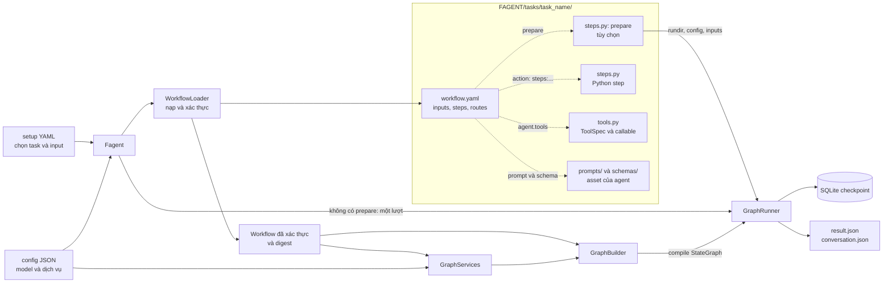
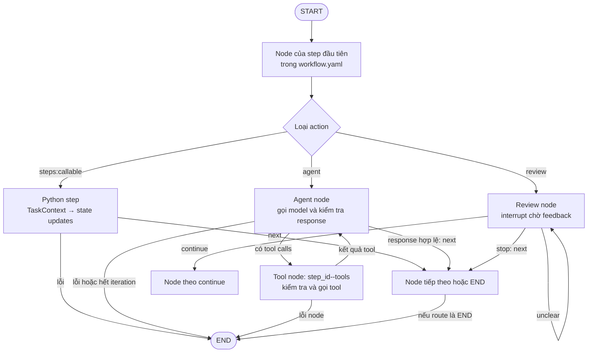
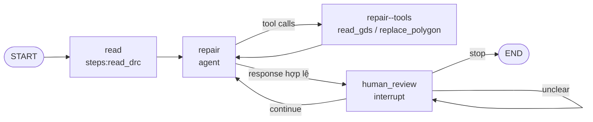

# Luồng thực thi FAGENT

Tài liệu này mô tả trạng thái mã và cấu hình workflow hiện có trong workspace. `workflow.yaml` của từng task quyết định các bước thực sự được chạy; sự tồn tại của một hàm trong mã không có nghĩa là bước đó đã được bật.

## Cấu trúc task và LangGraph

Mỗi task là một package khai báo workflow và cung cấp các thành phần được workflow tham chiếu. Engine dùng chung nạp package, dựng graph và chạy từng bộ input do task chuẩn bị.



`workflow.yaml` chọn callable và route; `GraphNodes` thực thi chúng thông qua `TaskContext` và `GraphServices`. Đường nét đứt thể hiện tham chiếu khai báo, không phải thứ tự thực thi. Nếu không có `prepare`, CLI tạo một lượt từ cấu hình task.

### Cấu trúc graph được biên dịch

Sơ đồ sau mô tả các loại node và route tổng quát. Các cạnh `next` và `continue` trỏ đến ID cụ thể trong YAML; không phải task nào cũng có đủ mọi loại node.



Mỗi node đọc và cập nhật `FagentState`; checkpoint lưu state theo thread. Lỗi của một lệnh gọi tool riêng lẻ được đưa vào conversation để agent xử lý, còn lỗi của node có thể kết thúc graph.

### Ví dụ: graph DRC đang bật



Bước `validate_drc` có trong mã nhưng đang bị comment trong YAML; `check_cover` cũng chưa được khai báo trong danh sách tool của agent. Cả hai không thuộc graph DRC hiện tại.

## Chạy và cấu hình

Từ thư mục gốc dự án:

```bash
python -m FAGENT --setup env_setup.yaml --config FAGENT/config.json --verbose
# Hoặc, sau khi cài package:
fagent --setup env_setup.yaml --config FAGENT/config.json --verbose
```

`Fagent.main()` gọi `Fagent.run()`, đọc setup YAML và config JSON rồi duyệt `tasks`. Đường dẫn tương đối trong setup được giải quyết từ thư mục chứa file YAML. Mỗi task được nạp từ `FAGENT/tasks/<task>/workflow.yaml`; tên task phải khớp tên thư mục. Nếu có `prepare`, callable này tạo các bộ `(rundir, config, inputs)` để chạy; nếu không, task dùng cấu hình đầu vào trực tiếp.

Ví dụ DRC:

```yaml
output_folder: output
list_cells: list
layer_map_files: [config/layer_mapping]
tasks:
  - drc:
      drc_folder: DRC
      gds_folder: DRC
      drc_files: DRC/rules.drc
      prompt: Fix DRC errors.
```

Với cell `ROM_MCELL0`, bước chuẩn bị đọc `DRC/ROM_MCELL0.gds`, `DRC/ROM_MCELL0.drc.results`, layer map và rule deck. Mỗi lần chạy DRC tạo thư mục mới `output/ROM_MCELL0/runs/<run_id>/rundir/`, trong đó `run_id` gồm thời gian UTC và phần định danh ngẫu nhiên. `InputLoader` phân tích đầu vào và ghi `gds.json`, `drc.json`. LVS dùng `output/lvs/rundir/`.

Config chọn `chat_backend: llama` hoặc `openai` (mặc định là `llama`). Backend llama dùng model GGUF cục bộ. Backend `openai` dùng endpoint tương thích OpenAI với `base_url`, tên model trong `agent_model_path`, và `api_key_env` là tên biến môi trường chứa API key. Với task bật `layout_services`, embedding cho RAG vẫn dùng `LlamaAdapter`, kể cả khi chat dùng API. Xem `FAGENT/config.example.json` và `FAGENT/integrations/models/` để cấu hình phù hợp.

## Nạp workflow và chạy graph

1. `WorkflowLoader` đọc YAML, xác thực cấu trúc, ID bước, route, input, prompt, schema và callable. Các asset phải nằm trong phạm vi đường dẫn được phép. Loader tính digest từ workflow và các asset/mã được tham chiếu.
2. `GraphServices` dựng prompt từ prompt task, prompt bổ sung, tham khảo RAG nếu có, và protocol. Với `layout_services: true`, service nạp layout, lập chỉ mục tài liệu tham khảo nếu được cấu hình cùng rule deck, rồi truy xuất tri thức liên quan. Các rule sạch được loại khỏi ngữ cảnh DRC.
3. `GraphBuilder` biên dịch bước đầu thành điểm vào LangGraph. `GraphRunner` tạo SQLite checkpointer và chạy graph với thread riêng.
4. Một bước Python nhận `TaskContext` gồm task, inputs, state và services, rồi trả mapping tương thích JSON. Lỗi bước hoặc thiếu input làm lượt chạy kết thúc `incomplete`.
5. Bước `agent` gọi model với conversation, schema phản hồi và các tool được khai báo riêng cho bước. Khi model yêu cầu tool, engine kiểm tra ID, tên và JSON Schema của đối số, gọi tool và thêm kết quả vào conversation trước khi quay lại agent. Phản hồi cuối phải hợp lệ theo schema; quá `max_iterations` sẽ kết thúc `incomplete`.
6. Bước `review` tạm dừng bằng interrupt. Feedback được phân loại `continue`, `stop` hoặc `unclear`: lần lượt đi tới `continue`, `next` hoặc hỏi lại. Feedback cũng được thêm vào conversation.

## Task DRC hiện tại

Route đang bật trong `FAGENT/tasks/drc/workflow.yaml`:

```text
read -> repair (agent <-> tools) -> human_review
                                      | continue -> repair
                                      | stop     -> END
```

- `read` đưa báo cáo DRC vào conversation. `repair` dùng prompt và schema của task.
- Agent hiện chỉ được cấp `read_gds` và `replace_polygon`. `read_gds` đọc polygon trực tiếp trong cell và ghi nhận cell đã được kiểm tra. `replace_polygon` yêu cầu đã đọc đúng cell, sửa theo `polygon_id`, lưu `candidate.gds`, lưu định danh polygon và ghi SHA-256 của candidate vào state. Tọa độ tool dùng GDS user units; marker Calibre dùng DBU và cần chuyển đổi bằng `dbu_per_user_unit`.
- `check_cover` đã được định nghĩa trong `tasks/drc/tools.py` để kiểm tra enclosure giữa hai polygon trực tiếp, nhưng chưa được khai báo trong danh sách tools của workflow nên agent hiện không gọi được tool này.
- `validate_drc` và backend Calibre Simulator có trong mã, nhưng bước `validate` đang được comment trong YAML và `repair.next` trỏ trực tiếp tới `human_review`. Vì vậy lượt DRC theo workflow hiện tại **không tự chạy validation**. Khi được nối vào workflow, validation kiểm tra digest candidate và dùng backend local mô phỏng; kết quả mô phỏng mang `simulated: true`. Backend EDA thật chưa được tích hợp.
- `knowledge_review` hiện cũng đang được comment, nên workflow DRC hiện tại không yêu cầu hay cho phép lưu case qua review.

Review tạo kết quả `incomplete` và trình bày response, candidate cùng validation nếu có; không xem câu trả lời của model là bằng chứng xác minh layout.

## Task LVS hiện tại

```text
read -> repair -> validate -> human_review
                                  | continue -> repair
                                  | stop     -> END
```

`read` báo `unavailable` vì chưa hỗ trợ định dạng báo cáo LVS; `repair` là placeholder `unavailable`. YAML hiện đặt `backend: local` và `mock_pass: true`, vì vậy validation trả bằng chứng mock có `simulated: true`, không phải kết quả LVS thực. Các đường dẫn tùy chọn `lvs_report`, `layout`, `netlist`, `deck` được giải quyết từ thư mục setup. Review vẫn tạo kết quả `incomplete`.

## Checkpoint, artifact và tri thức

`GraphRunner` lưu checkpoint theo `thread_id` trong `graph-checkpoints.sqlite3`. Khi tiếp tục review, runner kiểm tra identity gồm task, version, digest workflow và digest config; nếu có candidate thì kiểm tra đường dẫn và SHA-256 trước khi nạp lại layout và định danh polygon. Có thể resume qua API Python với cùng rundir và thread ID; CLI hiện chỉ có `--setup`, `--config`, `--verbose`.

| Artifact | Nội dung |
| --- | --- |
| `gds.json`, `drc.json` | Dữ liệu GDS và báo cáo DRC đã phân tích khi chuẩn bị input |
| `candidate.gds`, `polygon_ids.json` | Candidate đã lưu và định danh polygon, nếu có sửa thành công |
| `drc-validation-*/` | Kết quả mô phỏng DRC nếu bước validation được bật và chạy |
| `graph-checkpoints.sqlite3` | State và interrupt theo thread |
| `conversation.json` | Conversation, bao gồm yêu cầu và kết quả tool |
| `result.json` | Trạng thái, identity, input, output của step, candidate digest, validation và review |

Khi workflow bật `knowledge_review`, người dùng có thể đồng ý lưu qua lời nhắc riêng. `CaseLearner` chỉ được gọi khi review kết thúc với sự đồng ý rõ ràng và graph không lỗi. `--verbose` ghi trace điều hướng ra stderr. Kết quả được ghi vào `result.json`; lỗi được ghi với tiền tố `[ERROR]`.

## Mã nguồn chính

| Đường dẫn | Trách nhiệm |
| --- | --- |
| `FAGENT/fagent.py` | CLI, setup và điều phối các lượt chạy |
| `FAGENT/engine/workflow_loader.py` | Nạp, xác thực và tính digest workflow |
| `FAGENT/engine/graph_builder.py`, `graph_nodes.py` | Xây graph, thực thi step, agent, tool và review |
| `FAGENT/engine/graph_runner.py`, `graph_services.py` | Checkpoint, artifact, model, layout, RAG và backend EDA |
| `FAGENT/tasks/drc/`, `FAGENT/tasks/lvs/` | Workflow, step, tool, prompt và schema theo task |
| `FAGENT/capabilities/` | Phân tích DRC, đọc/sửa layout, định danh polygon và kiểm tra hình học |
| `FAGENT/integrations/` | Adapter model và backend DRC/LVS |
| `FAGENT/rag/`, `FAGENT/knowledge/` | Lập chỉ mục, truy xuất, lưu case và template dùng chung |
| `FAGENT/tasks/sample_task/`, `FAGENT/tasks/README.md` | Task mẫu và hướng dẫn tạo task mới |

Để kiểm tra nhanh các route và tool đang bật sau khi cấu hình thay đổi:

```bash
grep -nE '^(steps:|[[:space:]]*(- id:|action:|next:|continue:|tools:|knowledge_review:|layout_services:))' FAGENT/tasks/drc/workflow.yaml
```
