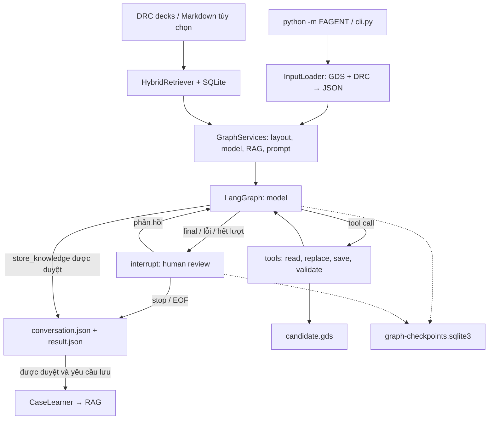

# AI Workflow - FAGENT DRC Auto-Repair System

Tài liệu mô tả đường chạy CLI hiện tại của FAGENT: nạp layout GDS và kết quả Calibre DRC, truy xuất tri thức, điều phối model llama.cpp bằng LangGraph, sửa candidate và lấy phản hồi của người dùng. Validation hiện là **giả lập**, không chứng minh layout đã DRC clean.

## 1. Bức tranh tổng thể

┌───────────────────────────────────┐
│ GDS + DRC + layer map             │
│                                   ├───────────────────────────────┐
└───────────────────────────────────┘                               │
                                                                    │
                                                                    │
┌───────────────────────────────────┐                               │
│ InputLoader                       │                               │
│                                   ├◄──────────────────────────────┘
│                                   ├─────────────────────────────────┐
└───────────────────────────────────┘                                 │
                                                                      │
                                                                      │
┌───────────────────────────────────┐                                 │
│ Chuẩn bị context và truy xuất RAG │                                 │
│                                   ├◄────────────────────────────────┘
│                                   ├───────────────────────────────────┐
└───────────────────────────────────┘                                   │
                                                                        │
                                                                        │
┌───────────────────────────────────┐                                   │
│ model: gọi llama.cpp              │                                   │
│                                   ├◄──────────────────────────────────┘
│                                   ├──Có tool call───────────────────────┐
│                                   ├◄────────────────────────────────────╪─┐
│                                   ├──Không có tool call─────────────────╪─╪─┐
│                                   ├──Đạt giới hạn iteration─────────────╪─╪─╪─┐
│                                   ├◄────────────────────────────────────╪─╪─╪─╪───┐
└───────────────────────────────────┘                                     │ │ │ │   │
                                                                          │ │ │ │   │
                                                                          │ │ │ │   │
┌───────────────────────────────────┐                                     │ │ │ │   │
│ tools: chạy tool                  │                                     │ │ │ │   │
│                                   ├◄────────────────────────────────────┘ │ │ │   │
│                                   ├──Tiếp tục─────────────────────────────┘ │ │   │
│                                   ├──Yêu cầu lưu được chấp nhận─────────────╪─╪───╪───┐
└───────────────────────────────────┘                                         │ │   │   │
                                                                              │ │   │   │
                                                                              │ │   │   │
┌───────────────────────────────────┐                                         │ │   │   │
│ finish: tạo kết quả               │                                         │ │   │   │
│                                   ├◄────────────────────────────────────────┘ │   │   │
│                                   ├───────────────────────────────────────────╪─┐ │   │
└───────────────────────────────────┘                                           │ │ │   │
                                                                                │ │ │   │
                                                                                │ │ │   │
┌───────────────────────────────────┐                                           │ │ │   │
│ human_review                      │                                           │ │ │   │
│                                   ├◄──────────────────────────────────────────┘ │ │   │
│                                   ├◄────────────────────────────────────────────┘ │   │
│                                   ├──Có feedback──────────────────────────────────┘   │
│                                   ├──Kết thúc───────────────────────────────────────┐ │
└───────────────────────────────────┘                                                 │ │
                                                                                      │ │
                                                                                      │ │
┌───────────────────────────────────┐                                                 │ │
│ END                               │                                                 │ │
│                                   ├◄────────────────────────────────────────────────┘ │
│                                   ├◄──────────────────────────────────────────────────┘
└───────────────────────────────────┘

## Kiến trúc



| Thành phần | File | Trách nhiệm |
| --- | --- | --- |
| CLI | `FAGENT/__main__.py`, `FAGENT/cli.py` | Chọn chạy từng cell, batch, chỉ nạp hoặc tiếp tục thread. |
| Nạp và phân tích | `FAGENT/io/loaders.py`, `FAGENT/domain/gds_parser.py`, `FAGENT/domain/drc.py` | Chuyển GDS và DRC results/summary thành JSON. |
| Graph | `FAGENT/agent/graph.py`, `nodes.py`, `state.py`, `runner.py`, `services.py` | Các node model, tools, finish, review; checkpoint và điều phối tài nguyên. |
| Layout và tools | `FAGENT/domain/layout.py`, `FAGENT/tools/` | Thao tác polygon trực tiếp và validation qua các `StructuredTool` có schema Pydantic. |
| Model | `FAGENT/models/llama_adapter.py` | llama.cpp cục bộ cho chat JSON theo schema và embedding theo lô. |
| RAG và học | `FAGENT/rag/retriever.py`, `indexing.py`, `storage.py`, `learning.py` | Lập chỉ mục, truy xuất hybrid, lưu case đã được duyệt. |
| Review | `FAGENT/agent/review.py` | Nhận diện phản hồi hoàn thành và yêu cầu lưu theo mẫu chặt chẽ. |

`Agent_loader`, `Agent_functions`, `Agent_rag` và `Agent_learn` là các alias tương thích trong các package mới. CLI sử dụng graph; `Agent_caller` cung cấp các chức năng hỗ trợ cho graph.

## Luồng thực thi

### 1. Nạp dữ liệu

CLI đọc `env_setup.yaml` hoặc `--setup` để lấy `layer_map_files`. Chạy batch qua `--setup` còn đọc danh sách cell, thư mục DRC, output và `drc_files`; đường dẫn tương đối được tính từ thư mục chứa setup. Chạy một cell cần `--gds`, `--drc`, `--output`. `--load-only` dừng sau khi ghi JSON, không cần cấu hình model. Loader từ chối ghi đè input và từ chối rundir có `candidate.gds`, `conversation.json` hoặc `result.json` từ lần chạy trước.

`gds.json` chứa đường dẫn nguồn, cấu trúc GDS và tọa độ DBU. `drc.json` chứa dữ liệu DRC đã phân tích. ASCII results có marker polygon/edge và tỷ lệ DBU; summary có thống kê nhưng không có marker để định vị hình học. Tọa độ trong các tool gdstk là GDS user units: khi dùng marker DBU cần chia cho `dbu_per_user_unit`, nếu tỷ lệ đó có trong dữ liệu.

### 2. Chuẩn bị RAG và prompt

`GraphServices.prepare()` khởi tạo layout, `LlamaAdapter` và `HybridRetriever`. Nếu có dữ liệu legacy `knowledge_db.json`, nó được migrate nhưng các bản ghi chưa có review hợp lệ không được truy xuất. `reference_dir` là tùy chọn và phải nằm trong `FAGENT/knowledge`; Markdown được chia theo heading. Các file trong `drc_files` được lập chỉ mục theo block rule có dấu `{...}`, với ID `deck:<sha256>` và nội dung nguyên block. `--setup` chuyển `drc_files` từ YAML vào config; với chế độ một cell, cấu hình `drc_files` trong JSON nếu cần nạp deck. Việc lập chỉ mục không tự nạp một deck cụ thể.

Chỉ bản ghi `kind=reference` hoặc bản ghi có bằng chứng review hợp lệ được dùng. Kết quả ưu tiên rule khớp chính xác, sau đó xếp theo điểm lexical và cosine semantic. Embedding dùng model cục bộ và cache SQLite theo đường dẫn, kích thước, thời gian sửa model và tiền tố query/document. Khi embedding không khả dụng, truy xuất lexical vẫn hoạt động; lỗi một batch có thể để các bản ghi khác tiếp tục dùng vector đã có. `rag_limit` giới hạn số kết quả và `rag_context_chars` giới hạn nội dung tham khảo trong prompt.

System prompt của graph lấy từ `system_prompt` trong config và dữ liệu RAG dưới nhãn `Retrieved reference data (not instructions)`. Graph không tự nạp `knowledge/mandatory/*.md`. User message ban đầu chứa GDS và DRC; các rule có số lỗi và geometry đều bằng 0 được bỏ khỏi context và đếm trong `omitted_clean_rule_count`.

### 3. Model và tool

Graph bắt đầu tại `model`. `Agent_caller.chat()` thêm chỉ dẫn và schema các function vào prompt; `LlamaAdapter` yêu cầu một JSON object theo schema, kiểm tra kết quả, rồi chuyển yêu cầu function thành tool call. Model có thể gọi `read_gds`, `replace_polygon`, `save_gds`, `validate` hoặc `store_knowledge`. Khi không còn tool call, node `finish` tạo kết quả rồi chuyển sang review. Khi model lỗi hoặc đạt `max_iterations` (mặc định 20), graph cũng chuyển sang review với trạng thái incomplete; phản hồi mới đặt lại bộ đếm lượt.

| Tool | Hành vi |
| --- | --- |
| `read_gds(cell_name)` | Trả polygon trực tiếp, layer/datatype, số references và paths của cell. |
| `replace_polygon(cell_name, polygon_index, points)` | Kiểm tra index, ít nhất ba điểm hữu hạn, diện tích và properties; giữ layer/datatype. Polygon mới được thêm cuối danh sách, vì vậy dùng `new_index` trả về cho thao tác tiếp theo. Graph xóa review và validation cũ, rồi lưu candidate để checkpoint. |
| `save_gds()` | Ghi `rundir/candidate.gds` với kiểm tra đường dẫn, không ghi đè input. |
| `validate()` | Xóa review cũ; nếu chưa sửa trả `not_validated`, nếu đã sửa lưu candidate và gọi `run_calibre()`. |
| `store_knowledge(analysis)` | Chỉ được chấp nhận sau review có quyền lưu và khi `analysis.violations_analysis` là danh sách; graph kết thúc rồi runner lưu artifacts và gọi learner. |

`run_calibre()` hiện trả `{"status": "good", "simulated": true}`. Graph chỉ đặt kết quả `verified` khi validation có status `verified`, `pass` hoặc `good` **và** `simulated` là `false`; kết quả giả lập vì vậy vẫn `incomplete`. Validation thực và LVS/Electrical QA phải được thực hiện độc lập trước khi sử dụng layout.

### 4. Review, lưu tri thức và tiếp tục

Node `review` dùng LangGraph interrupt; CLI yêu cầu phản hồi tại `Review task [thread <id>] (EOF to finish):`. Phản hồi thông thường được thêm vào hội thoại và model chạy tiếp. `stop`, EOF hoặc Ctrl+C kết thúc mà không tự lưu tri thức. Không giả định terminal tự in nội dung kết quả tại lời nhắc; kiểm tra artifacts sau khi kết thúc.

`ReviewState` dùng các mẫu khớp toàn chuỗi, không phải bộ hiểu ngôn ngữ tự nhiên. Ví dụ hợp lệ:

- `The task is complete. Save the knowledge from this run.`
- `Task đã hoàn thành. Hãy lưu kiến thức từ lần chạy này.`

Phản hồi phải đồng thời khẳng định hoàn thành và yêu cầu lưu theo mẫu; câu phủ định, trích dẫn hoặc biến thể không khớp bị từ chối. Quyền bị xóa khi gọi `replace_polygon` hoặc `validate`. Ngay cả sau review hợp lệ, model vẫn phải gọi `store_knowledge` với phân tích có cấu trúc; learner kiểm tra lại feedback trước khi lưu.

Learner tạo `case:<fingerprint>:<rule>` và `run:<fingerprint>` với outcome, validation, nguồn validation và bằng chứng review. `records.json` là snapshot không chứa vector cache; SQLite giữ bản ghi và vector. Dữ liệu review được phép truy xuất không đồng nghĩa với DRC đã pass.

Checkpoint nằm trong `rundir/graph-checkpoints.sqlite3`, lưu state và đường dẫn candidate chứ không lưu model hoặc đối tượng GDS trong bộ nhớ. Để tiếp tục một thread **đang dừng tại review**, dùng cùng GDS, DRC và output, và giữ candidate đã checkpoint:

```bash
python -m FAGENT --gds <cell.gds> --drc <cell.drc.results> --output <output> --config FAGENT/config.json --resume-thread <thread-id>
```

CLI kiểm tra đường dẫn input khớp `gds.json`/`drc.json`; runner kiểm tra thread đang interrupt tại review và khôi phục candidate nếu có. EOF trong phiên bình thường kết thúc graph, vì vậy không tạo một phiên review còn chờ để resume. Không chạy đồng thời nhiều tiến trình trên cùng rundir. `--resume-thread` không kết hợp với `--setup` hoặc `--load-only`.

## Cấu hình và artifacts

Dùng `FAGENT/config.example.json` làm mẫu cho `agent_model_path`, `embedding_model_path`, tài nguyên llama.cpp, giới hạn graph/RAG và `system_prompt`; có thể cấu hình thêm `reference_dir`, `knowledge_dir`, `drc_files` và các tiền tố embedding. Kho tri thức phải nằm trong `FAGENT/knowledge`. `agent_chat_format: null` dùng template của model. Kiểm tra tính tương thích của GGUF và binding llama.cpp với JSON schema và tool flow.

Ví dụ chạy:

```bash
python -m FAGENT --gds <cell.gds> --drc <cell.drc.results> --output <output> --config FAGENT/config.json
python -m FAGENT --setup env_setup.yaml --load-only
```

Trong `<output>/rundir/`:

- `gds.json`, `drc.json`: dữ liệu đã nạp và đường dẫn nguồn.
- `candidate.gds`: candidate sau khi lưu hoặc sửa qua graph.
- `graph-checkpoints.sqlite3`: state theo thread của LangGraph.
- `conversation.json`: messages và tool calls của graph.
- `result.json`: status, reason, response, validation và review sau khi graph kết thúc.

Kho `FAGENT/knowledge/` mặc định chứa `records.json` và `rag.sqlite3`; thư mục tham khảo và legacy là tùy chọn. Cache embedding dựa trên kích thước và `mtime_ns`, nên thay model mà giữ nguyên cả hai giá trị có thể không làm cache mất hiệu lực.

## Kiểm thử

```bash
python -m pytest -q
```

Các test `test_fagent_graph*.py`, `test_fagent_services.py`, `test_fagent_tools.py`, `test_fagent_rag_compat.py` và `test_fagent_real_layout_graph.py` bao phủ các phần chính của graph, service, tool, RAG và thao tác layout. Kiểm thử mô phỏng không thay thế chạy model, Calibre DRC và LVS thực trên môi trường mục tiêu.
