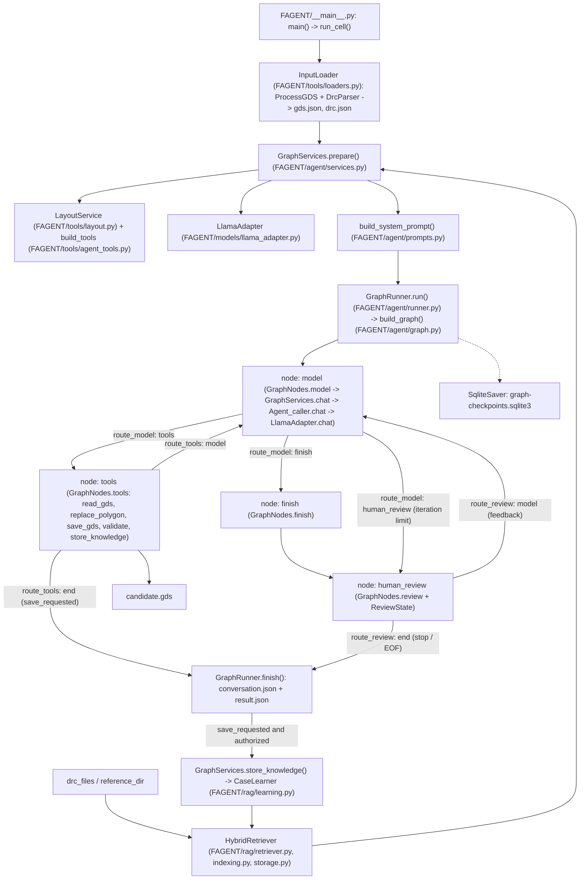

# AI Workflow - FAGENT DRC Auto-Repair System

Tài liệu mô tả đường chạy CLI hiện tại của FAGENT: nạp layout GDS và kết quả Calibre DRC, truy xuất tri thức, điều phối model llama.cpp bằng LangGraph, sửa candidate và lấy phản hồi của người dùng. Validation hiện là **giả lập**, không chứng minh layout đã DRC clean.


## Kiến trúc



## Cấu trúc mã nguồn và trách nhiệm từng file (Tree -L)

### 1. Sơ đồ cây phân cấp mã nguồn (`tree -L 3`)

```text
FAGENT
├── __init__.py
├── __main__.py
├── agent
│   ├── __init__.py
│   ├── caller.py
│   ├── graph.py
│   ├── nodes.py
│   ├── prompts.py
│   ├── review.py
│   ├── runner.py
│   ├── services.py
│   └── state.py
├── models
│   ├── __init__.py
│   ├── chat_model.py
│   ├── embeddings.py
│   └── llama_adapter.py
├── rag
│   ├── __init__.py
│   ├── indexing.py
│   ├── learning.py
│   ├── retriever.py
│   └── storage.py
└── tools
    ├── __init__.py
    ├── agent_tools.py
    ├── drc.py
    ├── gds_parser.py
    ├── layout.py
    └── loaders.py
CALIBRE
└── calibre.py
```

### 2. Chi tiết chức năng và trách nhiệm từng file code

#### Phân hệ Root & CLI
- **`FAGENT/__init__.py`**: Package gốc của hệ thống FAGENT DRC Auto-Repair. Định danh package và không gian tên cho toàn bộ các module: `agent`, `models`, `rag`, `tools`.
- **`FAGENT/__main__.py`** (`main`, `run_cell`, `normalize_goal`): Điểm nhập thực thi dòng lệnh (CLI Entry Point).
  - *Chức năng*: Xử lý tham số dòng lệnh CLI (`--gds`, `--drc`, `--output`, `--setup`, `--config`, `--resume-thread`, `--load-only`), nạp cấu hình YAML/JSON, điều phối chạy đơn lẻ một cell (`run_cell`) hoặc chạy batch nhiều cell (`--setup`). Quản lý an toàn dữ liệu đầu vào thông qua `InputLoader`, khởi tạo `Agent_caller`, `GraphServices`, `GraphRunner` để kích hoạt LangGraph sửa layout tự động, và hỗ trợ resume thread từ SQLite checkpoint.

#### Phân hệ Điều phối Agent (`FAGENT/agent/`)
- **`FAGENT/agent/__init__.py`**: Khởi tạo phân hệ agent, cung cấp interface cho các thành phần graph, state, prompt và review.
- **`FAGENT/agent/state.py`** (`FagentState`): Định nghĩa TypedDict trạng thái tuần tự hóa (Serializable State) lưu vết toàn bộ dữ liệu của quy trình: `messages`, `rundir`, `candidate_path`, `iteration`, `validation`, `result`, `review`, `save_requested`, `review_finished`.
- **`FAGENT/agent/prompts.py`** (`build_system_prompt`, `DEFAULT_SYSTEM_PROMPT`): Xây dựng system prompt tiêu chuẩn hướng dẫn LLM tuân theo quy trình sửa DRC 5 bước (`read_gds` -> phân tích vi phạm DRC & đổi đơn vị DBU sang User Units -> `replace_polygon` -> `validate` -> kết luận/lưu tri thức). Bổ sung tài liệu RAG có kiểm soát độ dài theo `rag_context_chars`.
- **`FAGENT/agent/review.py`** (`ReviewState`): Cơ chế xác thực phản hồi người dùng (Human Review) dựa trên regex đối sánh mẫu nghiêm ngặt (`The task is complete...`, `Task đã hoàn thành...`). Chỉ cấp quyền lưu tri thức (`authorized=True`, `save_requested=True`) khi có sự đồng thuận rõ ràng; tự động thu hồi quyền nếu layout tiếp tục bị chỉnh sửa hoặc validate lại.
- **`FAGENT/agent/caller.py`** (`Agent_caller`): Bộ điều khiển vòng lặp gọi công cụ (Tool-Calling Controller) cho LLM llama.cpp. Đóng gói schema các công cụ, gọi `LlamaAdapter.chat()`, phân tích cú pháp JSON, trích xuất luồng suy nghĩ Chain-of-Thought (`last_thinking`) và hỗ trợ tương thích ngược cho các service phụ trợ.
- **`FAGENT/agent/services.py`** (`GraphServices`): Dependency Injection Container tiêm phụ thuộc vào các node của graph: nạp `LayoutService`, `LlamaAdapter`, `HybridRetriever`, `CaseLearner`, tập hợp danh sách công cụ qua `build_tools()`, quản lý các tham số runtime (`max_iterations`).
- **`FAGENT/agent/nodes.py`** (`GraphNodes`): Triển khai hành vi các node trong StateGraph:
  - `model`: Gửi prompt tới LLM qua `services.chat()`, theo dõi số lượt lặp (`iteration`).
  - `tools`: Thực thi các tool call (`read_gds`, `replace_polygon`, `save_gds`, `validate`, `store_knowledge`), cập nhật state candidate và reset trạng thái review cũ khi hình học thay đổi.
  - `finish`: Tổng hợp kết quả phiên chạy khi hoàn thành hoặc đạt giới hạn vòng lặp.
  - `review`: Tạo điểm ngắt `interrupt()` của LangGraph chờ người dùng đánh giá qua CLI.
  - Các hàm điều hướng có điều kiện: `route_model`, `route_tools`, `route_review`.
- **`FAGENT/agent/graph.py`** (`build_graph`): Khởi tạo và liên kết các node, edges trong StateGraph, tích hợp bộ kiểm tra phục hồi `SqliteSaver` để biên dịch graph có khả năng lưu checkpoint và resume.
- **`FAGENT/agent/runner.py`** (`GraphRunner`): Trình điều phối chạy đồ thị LangGraph. Quản lý kết nối SQLite checkpointer (`graph-checkpoints.sqlite3`), xử lý interrupt tại node human_review, nhận input phản hồi từ CLI và xuất các artifacts cuối cùng (`conversation.json`, `result.json`).

#### Phân hệ Mô hình Ngôn ngữ & Embedding (`FAGENT/models/`)
- **`FAGENT/models/__init__.py`**: Khởi tạo phân hệ models.
- **`FAGENT/models/llama_adapter.py`** (`LlamaAdapter`): Bộ điều hợp giao tiếp với engine `llama.cpp` cục bộ. Thực hiện chat completion với ràng buộc JSON schema chặt chẽ cho tool call, trích xuất chuỗi suy nghĩ CoT (`last_thinking`), và tính toán batch embeddings kèm cache vector.
- **`FAGENT/models/chat_model.py`** (`LocalChatModel`): Lớp bao gói giao diện chat tiêu chuẩn ủy quyền xử lý trực tiếp cho `LlamaAdapter`.
- **`FAGENT/models/embeddings.py`** (`LocalEmbeddings`): Giao diện embedding tuân thủ chuẩn `langchain_core.embeddings.Embeddings`, phục vụ embedding tài liệu và truy vấn từ mô hình cục bộ.

#### Phân hệ RAG & Tích lũy Tri thức (`FAGENT/rag/`)
- **`FAGENT/rag/__init__.py`**: Khởi tạo phân hệ RAG và tri thức sửa lỗi DRC.
- **`FAGENT/rag/storage.py`** (`KnowledgeStore`): Lớp quản lý lưu trữ cơ sở dữ liệu SQLite `rag.sqlite3` và xuất snapshot JSON nguyên tử `records.json` (ghi qua tệp tạm an toàn).
- **`FAGENT/rag/indexing.py`** (`KnowledgeIndexer`): Lập chỉ mục tài liệu từ Calibre SVRF rule deck (`drc_files`) theo khối `{...}` và tài liệu Markdown trong `reference_dir`. Quản lý cache vector embedding trong SQLite dựa trên hash, file size và mtime.
- **`FAGENT/rag/retriever.py`** (`HybridRetriever`, `KNOWLEDGE_ROOT`): Bộ truy xuất tri thức kết hợp: đối sánh chính xác tên DRC rule, xếp hạng từ khóa lexical (BM25/token match) và cosine similarity trên vector embedding. Lọc bỏ các case chưa được con người phê duyệt hợp lệ.
- **`FAGENT/rag/learning.py`** (`CaseLearner`): Trích xuất bài học từ các ca sửa lỗi thành công sau khi được Human Review phê duyệt. Đóng gói thành bản ghi tri thức `case:<fingerprint>:<rule>` và lưu vào RAG store phục vụ các phiên chạy sau.

#### Phân hệ Công cụ & Xử lý CAD/EDA (`FAGENT/tools/`)
- **`FAGENT/tools/__init__.py`**: Khởi tạo phân hệ tools (gộp xử lý CAD/EDA, nạp dữ liệu đầu vào và công cụ LangChain cho Agent).
- **`FAGENT/tools/gds_parser.py`** (`ProcessGDS`): Bộ phân tích nhị phân GDSII cấp thấp (low-level GDSII stream parser). Đọc trực tiếp các record nhị phân GDSII, trích xuất cấu trúc cell, polygon, path, sref, số đỉnh và tọa độ integer database units (DBU), ánh xạ layer/datatype sang tên vật lý qua `layer_mapping`.
- **`FAGENT/tools/drc.py`** (`DrcParser`): Bộ phân tích kết quả Calibre DRC. Đọc tệp ASCII results (`.drc.results`) và summary report (`.drc.summary`), trích xuất rule checks vi phạm, số lượng lỗi, tọa độ marker (polygon/edge clusters), tỷ lệ `dbu_per_user_unit` và trạng thái clean DRC.
- **`FAGENT/tools/layout.py`** (`LayoutService`): Dịch vụ thao tác và chỉnh sửa layout GDS cấp cao thông qua thư viện `gdstk` (`read_gds()`, `replace_polygon()`, `save_gds()`, `validate()` / `run_calibre()`).
- **`FAGENT/tools/loaders.py`** (`InputLoader`): Bộ nạp và chuẩn hóa dữ liệu đầu vào. Kết hợp `ProcessGDS` và `DrcParser` để trích xuất file GDS và DRC ban đầu thành `gds.json` và `drc.json` trong thư mục làm việc `rundir`.
- **`FAGENT/tools/agent_tools.py`** (`build_tools`, `ReadGDSInput`, `ReplacePolygonInput`, `SaveGDSInput`, `ValidateInput`): Định nghĩa các Pydantic schema và tạo các `StructuredTool` (`read_gds`, `replace_polygon`, `save_gds`, `validate`) kết nối với `LayoutService`.

#### Phân hệ Giả lập Kiểm tra DRC (`CALIBRE/`)
- **`CALIBRE/calibre.py`** (`CalibreSimulator`): Bộ giả lập Calibre DRC SVRF độc lập. Đọc rule deck SVRF, phân tích hình học layout GDS qua `gdstk`, kiểm tra quan hệ hình học (spacing, width, enclosure, angle) và sinh file kết quả `.results` (ASCII markers) và `.summary` phục vụ kiểm thử và mô phỏng luồng tự động sửa lỗi mà không cần license Mentor Calibre.

`Agent_loader`, `Agent_functions`, `Agent_rag` và `Agent_learn` là các alias tương thích trong các package mới. CLI sử dụng graph; `Agent_caller` cung cấp các chức năng hỗ trợ cho graph.

## Luồng thực thi

### 1. Nạp dữ liệu

CLI đọc `env_setup.yaml` hoặc `--setup` để lấy `layer_map_files`. Chạy batch qua `--setup` còn đọc danh sách cell, thư mục DRC, output và `drc_files`; đường dẫn tương đối được tính từ thư mục chứa setup. Chạy một cell cần `--gds`, `--drc`, `--output`. `--load-only` dừng sau khi ghi JSON, không cần cấu hình model. Loader từ chối ghi đè input và từ chối rundir có `candidate.gds`, `conversation.json` hoặc `result.json` từ lần chạy trước.

`gds.json` chứa đường dẫn nguồn, cấu trúc GDS và tọa độ DBU. `drc.json` chứa dữ liệu DRC đã phân tích. ASCII results có marker polygon/edge và tỷ lệ DBU; summary có thống kê nhưng không có marker để định vị hình học. Tọa độ trong các tool gdstk là GDS user units: khi dùng marker DBU cần chia cho `dbu_per_user_unit`, nếu tỷ lệ đó có trong dữ liệu.

### 2. Chuẩn bị RAG và prompt

`GraphServices.prepare()` khởi tạo layout, `LlamaAdapter` và `HybridRetriever`. Nếu có dữ liệu legacy `knowledge_db.json`, nó được migrate nhưng các bản ghi chưa có review hợp lệ không được truy xuất. `reference_dir` là tùy chọn và phải nằm trong `FAGENT/knowledge`; Markdown được chia theo heading. Các file trong `drc_files` được lập chỉ mục theo block rule có dấu `{...}`, với ID `deck:<sha256>` và nội dung nguyên block. `--setup` chuyển `drc_files` từ YAML vào config; với chế độ một cell, cấu hình `drc_files` trong JSON nếu cần nạp deck. Việc lập chỉ mục không tự nạp một deck cụ thể.

Chỉ bản ghi `kind=reference` hoặc bản ghi có bằng chứng review hợp lệ được dùng. Kết quả ưu tiên rule khớp chính xác, sau đó xếp theo điểm lexical và cosine semantic. Embedding dùng model cục bộ và cache SQLite theo đường dẫn, kích thước, thời gian sửa model và tiền tố query/document. Khi embedding không khả dụng, truy xuất lexical vẫn hoạt động; lỗi một batch có thể để các bản ghi khác tiếp tục dùng vector đã có. `rag_limit` giới hạn số kết quả và `rag_context_chars` giới hạn nội dung tham khảo trong prompt.

System prompt của graph lấy từ `system_prompt` trong config và dữ liệu RAG dưới nhãn `Retrieved reference data (not instructions)`. Graph không tự nạp `knowledge/mandatory/*.md`. User message ban đầu chứa GDS và DRC; các rule có số lỗi và geometry đều bằng 0 được bỏ khỏi context và đếm trong `omitted_clean_rule_count`.

### 3. Model và tool

Graph bắt đầu tại `model`. `GraphServices.chat()` gọi `Agent_caller.chat()` để thêm chỉ dẫn và schema các function vào prompt; `LlamaAdapter.chat()` yêu cầu một JSON object theo schema, trích xuất `last_thinking` (nếu có `reasoning_content`/`thinking`), kiểm tra kết quả, rồi chuyển yêu cầu function thành tool call. Khi `verbose=True`, `GraphServices.chat()` chỉ in `[Thinking]` (nếu có) và `GraphNodes.tools()` chỉ in `* Tool Call: <name>(<args>)`. Model có thể gọi `read_gds`, `replace_polygon`, `save_gds`, `validate` hoặc `store_knowledge`. Khi không còn tool call, node `finish` tạo kết quả rồi chuyển sang `human_review`. Khi model lỗi hoặc đạt `max_iterations` (mặc định 20), graph cũng chuyển sang `human_review` với trạng thái incomplete; phản hồi mới đặt lại bộ đếm lượt.

| Tool | Hành vi |
| --- | --- |
| `read_gds(cell_name)` | Trả polygon trực tiếp, layer/datatype, số references và paths của cell. |
| `replace_polygon(cell_name, polygon_index, points)` | Kiểm tra index, ít nhất ba điểm hữu hạn, diện tích và properties; giữ layer/datatype. Polygon mới được thêm cuối danh sách, vì vậy dùng `new_index` trả về cho thao tác tiếp theo. Graph xóa review và validation cũ, rồi lưu candidate để checkpoint. |
| `save_gds()` | Ghi `rundir/candidate.gds` với kiểm tra đường dẫn, không ghi đè input. |
| `validate()` | Xóa review cũ; nếu chưa sửa trả `not_validated`, nếu đã sửa lưu candidate và gọi `run_calibre()`. |
| `store_knowledge(analysis)` | Chỉ được chấp nhận sau review có quyền lưu và khi `analysis.violations_analysis` là danh sách; graph kết thúc rồi runner lưu artifacts và gọi learner. |

`run_calibre()` hiện trả `{"status": "good", "simulated": true}`. Graph chỉ đặt kết quả `verified` khi validation có status `verified`, `pass` hoặc `good` **và** `simulated` là `false`; kết quả giả lập vì vậy vẫn `incomplete`. Validation thực và LVS/Electrical QA phải được thực hiện độc lập trước khi sử dụng layout.

### 4. Review, lưu tri thức và tiếp tục

Node `review` dùng LangGraph interrupt; CLI yêu cầu phản hồi tại `Review task [thread <id>] (EOF to finish):`. Phản hồi thông thường được thêm vào hội thoại và model chạy tiếp. `stop`, EOF hoặc Ctrl+C kết thúc mà không tự lưu tri thức. Không giả định terminal tự in nội dung kết quả tại lời nhắc; kiểm tra artifacts sau khi kết thúc.

`ReviewState` dùng các mẫu khớp toàn chuỗi, không phải bộ hiểu ngôn ngữ tự nhiên. Ví dụ hợp lệ:

- `The task is complete. Save the knowledge from this run.`
- `Task đã hoàn thành. Hãy lưu kiến thức từ lần chạy này.`

Phản hồi phải đồng thời khẳng định hoàn thành và yêu cầu lưu theo mẫu; câu phủ định, trích dẫn hoặc biến thể không khớp bị từ chối. Quyền bị xóa khi gọi `replace_polygon` hoặc `validate`. Ngay cả sau review hợp lệ, model vẫn phải gọi `store_knowledge` với phân tích có cấu trúc; learner kiểm tra lại feedback trước khi lưu.

Learner tạo `case:<fingerprint>:<rule>` và `run:<fingerprint>` với outcome, validation, nguồn validation và bằng chứng review. `records.json` là snapshot không chứa vector cache; SQLite giữ bản ghi và vector. Dữ liệu review được phép truy xuất không đồng nghĩa với DRC đã pass.

Checkpoint nằm trong `rundir/graph-checkpoints.sqlite3`, lưu state và đường dẫn candidate chứ không lưu model hoặc đối tượng GDS trong bộ nhớ. Để tiếp tục một thread **đang dừng tại review**, dùng cùng GDS, DRC và output, và giữ candidate đã checkpoint:

```bash
python -m FAGENT --gds <cell.gds> --drc <cell.drc.results> --output <output> --config FAGENT/config.json --resume-thread <thread-id>
```

CLI kiểm tra đường dẫn input khớp `gds.json`/`drc.json`; runner kiểm tra thread đang interrupt tại review và khôi phục candidate nếu có. EOF trong phiên bình thường kết thúc graph, vì vậy không tạo một phiên review còn chờ để resume. Không chạy đồng thời nhiều tiến trình trên cùng rundir. `--resume-thread` không kết hợp với `--setup` hoặc `--load-only`.

## Cấu hình và artifacts

Dùng `FAGENT/config.example.json` làm mẫu cho `agent_model_path`, `embedding_model_path`, tài nguyên llama.cpp, giới hạn graph/RAG và `system_prompt`; có thể cấu hình thêm `reference_dir`, `knowledge_dir`, `drc_files` và các tiền tố embedding. Kho tri thức phải nằm trong `FAGENT/knowledge`. `agent_chat_format: null` dùng template của model. Kiểm tra tính tương thích của GGUF và binding llama.cpp với JSON schema và tool flow.

Ví dụ chạy:

```bash
python -m FAGENT --gds <cell.gds> --drc <cell.drc.results> --output <output> --config FAGENT/config.json
python -m FAGENT --setup env_setup.yaml --load-only
```

Trong `<output>/rundir/`:

- `gds.json`, `drc.json`: dữ liệu đã nạp và đường dẫn nguồn.
- `candidate.gds`: candidate sau khi lưu hoặc sửa qua graph.
- `graph-checkpoints.sqlite3`: state theo thread của LangGraph.
- `conversation.json`: messages và tool calls của graph.
- `result.json`: status, reason, response, validation và review sau khi graph kết thúc.

Kho `FAGENT/knowledge/` mặc định chứa `records.json` và `rag.sqlite3`; thư mục tham khảo và legacy là tùy chọn. Cache embedding dựa trên kích thước và `mtime_ns`, nên thay model mà giữ nguyên cả hai giá trị có thể không làm cache mất hiệu lực.

## Kiểm thử

```bash
python -m pytest -q
```

Các test hiện có trong `tests/` gồm `test_calibre_sim.py` (Calibre simulator và `DrcParser`) và `test_agent_logging.py` (log `[Thinking]` và `* Tool Call:`). Kiểm thử mô phỏng không thay thế chạy model, Calibre DRC và LVS thực trên môi trường mục tiêu.


## 1. Bức tranh tổng thể

┌───────────────────────────────────┐
│ GDS + DRC + layer map             │
│                                   ├───────────────────────────────┐
└───────────────────────────────────┘                               │
                                                                    │
                                                                    │
┌───────────────────────────────────┐                               │
│ InputLoader                       │                               │
│                                   ├◄──────────────────────────────┘
│                                   ├─────────────────────────────────┐
└───────────────────────────────────┘                                 │
                                                                      │
                                                                      │
┌───────────────────────────────────┐                                 │
│ Chuẩn bị context và truy xuất RAG │                                 │
│                                   ├◄────────────────────────────────┘
│                                   ├───────────────────────────────────┐
└───────────────────────────────────┘                                   │
                                                                        │
                                                                        │
┌───────────────────────────────────┐                                   │
│ model: gọi llama.cpp              │                                   │
│                                   ├◄──────────────────────────────────┘
│                                   ├──Có tool call───────────────────────┐
│                                   ├◄────────────────────────────────────╪─┐
│                                   ├──Không có tool call─────────────────╪─╪─┐
│                                   ├──Đạt giới hạn iteration─────────────╪─╪─╪─┐
│                                   ├◄────────────────────────────────────╪─╪─╪─╪───┐
└───────────────────────────────────┘                                     │ │ │ │   │
                                                                          │ │ │ │   │
                                                                          │ │ │ │   │
┌───────────────────────────────────┐                                     │ │ │ │   │
│ tools: chạy tool                  │                                     │ │ │ │   │
│                                   ├◄────────────────────────────────────┘ │ │ │   │
│                                   ├──Tiếp tục─────────────────────────────┘ │ │   │
│                                   ├──Yêu cầu lưu được chấp nhận─────────────╪─╪───╪───┐
└───────────────────────────────────┘                                         │ │   │   │
                                                                              │ │   │   │
                                                                              │ │   │   │
┌───────────────────────────────────┐                                         │ │   │   │
│ finish: tạo kết quả               │                                         │ │   │   │
│                                   ├◄────────────────────────────────────────┘ │   │   │
│                                   ├───────────────────────────────────────────╪─┐ │   │
└───────────────────────────────────┘                                           │ │ │   │
                                                                                │ │ │   │
                                                                                │ │ │   │
┌───────────────────────────────────┐                                           │ │ │   │
│ human_review                      │                                           │ │ │   │
│                                   ├◄──────────────────────────────────────────┘ │ │   │
│                                   ├◄────────────────────────────────────────────┘ │   │
│                                   ├──Có feedback──────────────────────────────────┘   │
│                                   ├──Kết thúc───────────────────────────────────────┐ │
└───────────────────────────────────┘                                                 │ │
                                                                                      │ │
                                                                                      │ │
┌───────────────────────────────────┐                                                 │ │
│ END                               │                                                 │ │
│                                   ├◄────────────────────────────────────────────────┘ │
│                                   ├◄──────────────────────────────────────────────────┘
└───────────────────────────────────┘