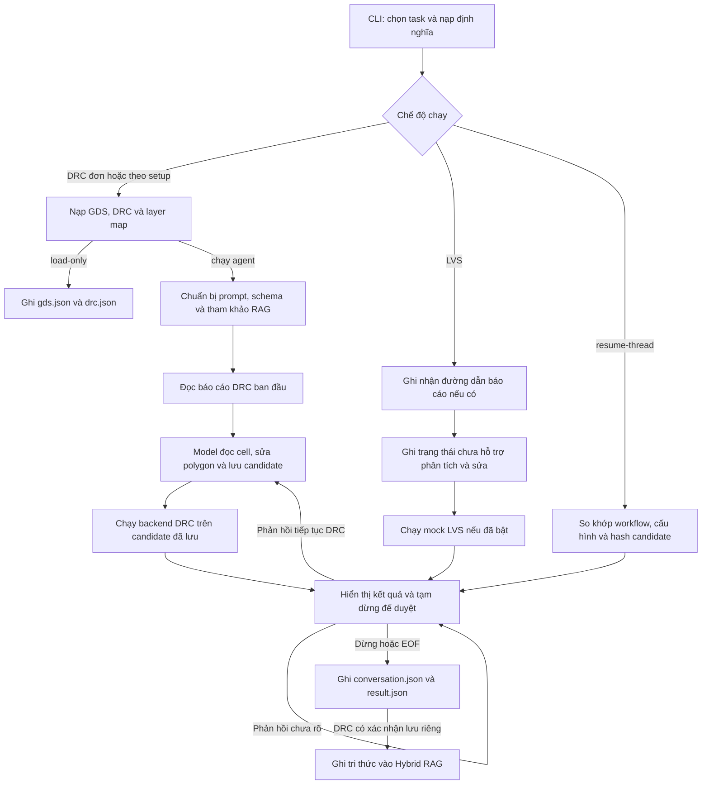

# Flow DRC và LVS của FAGENT

`python -m FAGENT` và `fagent` vào cùng CLI ở `FAGENT/__main__.py`. DRC là tác vụ mặc định. Dùng `--task lvs` để chạy khung LVS hoặc `--workflow` để chọn YAML khác. CLI nạp và kiểm tra YAML, prompt, schema và công cụ đã đăng ký trước khi tạo LangGraph.

## Từ đầu vào đến bước duyệt

## Các nhánh và bằng chứng

- **DRC.** `InputLoader` chuẩn hóa dữ liệu trong `rundir`. Model chỉ gọi công cụ đọc và sửa hình học đã đăng ký. Tọa độ marker DRC ở DBU được chia cho `dbu_per_user_unit` trước khi dùng trong công cụ sửa polygon. Candidate giữ layer và datatype của polygon. LangGraph gọi backend sau khi có candidate đã lưu, đưa báo cáo mới vào bước duyệt và ghi đường dẫn báo cáo trong kết quả.
- **Backend DRC.** Chế độ local chạy Calibre Simulator khi có rule deck và dùng mock khi thiếu deck. Kết quả giả lập có `simulated: true` và trạng thái tổng thể `incomplete`. Chế độ real trả về `unavailable` cho đến khi có hợp đồng gọi công cụ và xác thực báo cáo.
- **LVS.** Workflow ghi nhận đầu vào, đánh dấu phần phân tích báo cáo và sửa layout là `unavailable`, rồi chạy mock nếu được cấu hình. Mock có thể trả về `pass` kèm `simulated: true`. Trạng thái tổng thể là `incomplete`.
- **Duyệt và tiếp tục.** Agent phân loại phản hồi thành dừng, tiếp tục hoặc chưa rõ. DRC quay lại bước sửa khi có yêu cầu tiếp tục. LVS giữ phiên ở bước duyệt. Phản hồi dừng hoặc EOF kết thúc phiên. Việc lưu tri thức DRC cần xác nhận riêng ở lượt duyệt kết thúc.
- **Checkpoint.** SQLite ghi trạng thái LangGraph, định danh workflow, digest cấu hình và hash candidate. Khi resume, runner kiểm tra các giá trị này trước khi khôi phục candidate và mở lại bước duyệt.

## Vị trí mã và cấu hình

| Vị trí | Vai trò |
| --- | --- |
| `FAGENT/workflows/` và `FAGENT/knowledge/prompts/` | Thứ tự bước, backend, prompt, mô tả công cụ và schema |
| `FAGENT/engine/` | Xác thực workflow, điều phối LangGraph, review, checkpoint và artifact |
| `FAGENT/capabilities/` | Nạp GDS, thao tác polygon và đọc báo cáo DRC |
| `FAGENT/integrations/` | Adapter llama.cpp, Calibre Simulator và mock LVS |
| `FAGENT/rag/` | Truy xuất tham khảo và lưu tri thức DRC theo quyền đã ghi nhận |

Tham số CLI, ví dụ chạy và định dạng output có trong [README](../README.md).
